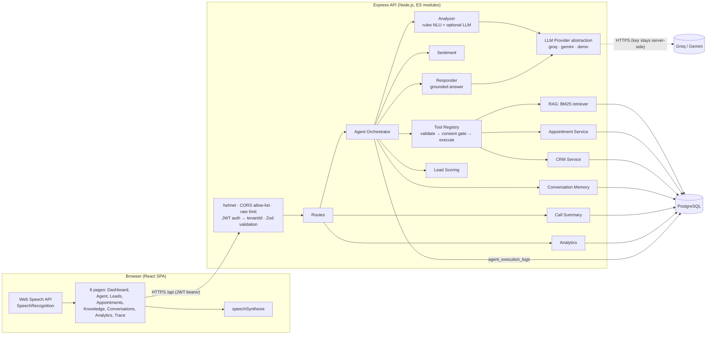
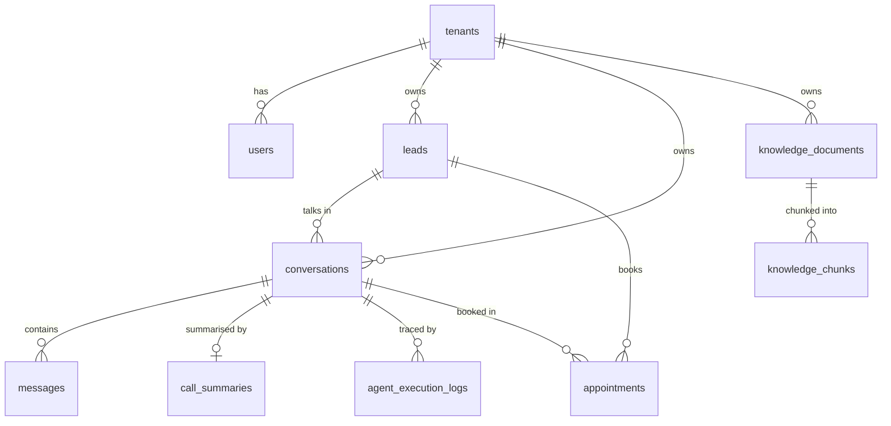

# VaaniQ Architecture

## 1. System overview

A **modular monolith**: one Node.js/Express process with clearly separated service modules, one PostgreSQL database, and a React SPA. No microservices. Each module could be extracted later, but today the extra network hops and operational cost would buy nothing.



**Hard rule:** the LLM never touches the database. Model output is *data* that is validated, merged with deterministic rules, and turned into tool calls by backend code. The tool registry is the only path to business-state changes.

## 2. One agent turn (request flow)

`POST /api/conversations/:id/messages { text, language }` → `services/agent/orchestrator.js#handleTurn`

```mermaid
sequenceDiagram
  participant C as Customer (browser)
  participant O as Orchestrator
  participant A as Analyzer
  participant T as Tool Registry
  participant DB as PostgreSQL
  C->>O: text (+language)
  O->>DB: load conversation state + last 12 messages + lead
  O->>A: analyze(text, state)
  A-->>O: intent, entities, sentiment (rules; LLM additions validated)
  O->>DB: save customer message + sentiment
  O->>T: update_lead(new facts)  [Zod-validated]
  alt human request / sustained negative
    O->>T: escalate_to_human
  else customer said "yes" to a pending proposal
    O->>T: book_appointment (consent gate checks exact proposal)
    T->>DB: BEGIN · lock lead · INSERT (unique slot index) · COMMIT
  else
    O->>T: search_knowledge_base (BM25) → grounded answer + citations
    O->>T: check_availability → offer slots / ask contact / PROPOSE booking
  end
  O->>O: scoreLead(profile) → saveScore
  O->>DB: save agent message, state, decision trace
  O-->>C: reply, sources, score, trace, pendingConfirmation, offeredSlots
  C->>C: speak reply (TTS)
```

## 3. Booking state machine (stored in `conversations.state`)


## 4. Data model



Key constraints (from `backend/src/db/migrations/001_init.sql`):
- Every business table has `tenant_id` (FK, `ON DELETE CASCADE`) and indexes that lead with `tenant_id`.
- `appointments_slot_uq`: `UNIQUE (tenant_id, starts_at) WHERE status = 'confirmed'`. The database itself prevents double-booking.
- `leads_tenant_phone_uq`: one lead per phone per tenant (repeat-caller merge).
- `call_summaries.conversation_id UNIQUE`: one summary per call, upserted.
- CHECK constraints on every status/enum column and on `score BETWEEN 0 AND 100`.

## 5. Module responsibilities

| Module | Responsibility |
|---|---|
| `agent/orchestrator.js` | Runs a turn: decides the primary action, calls tools, composes the reply, persists the trace |
| `agent/analyzer.js` | Rule NLU always; optional LLM JSON analysis validated with Zod and merged *additively* |
| `agent/responder.js` | Answers from retrieved chunks only (LLM-grounded or extractive) |
| `agent/templates.js` | EN/HI/TE fragments. Booking/slot statements are always templated |
| `tools/registry.js` | Registry, argument validation, consent gate, execution record |
| `tools/index.js` | `search_knowledge_base`, `check_availability`, `update_lead`, `book_appointment`, `escalate_to_human` |
| `rag/*` | Chunking, BM25, ingestion, retrieval with relevance threshold, query expansion |
| `nlu.js` / `sentiment.js` / `lexicon.js` | Deterministic multilingual extraction, intent flags, sentiment with evidence |
| `leadScoring.js` | Configurable 100-point model with reasons and missing info |
| `memory.js` | Conversations, messages, 12-message window, state persistence |
| `crm.js` | Leads, fact merge (never overwrite with empty), phone merge, status rules |
| `appointments.js` | Slot policy, availability, transactional booking, reschedule, cancel |
| `summary.js` | Structured call summary + rule-based next actions (+ optional LLM narrative) |
| `analytics.js` | Live SQL aggregates for the dashboard and analytics pages |
| `llm/*` | Provider abstraction: `chat({system, messages, json})`, timeouts, no key logging |
