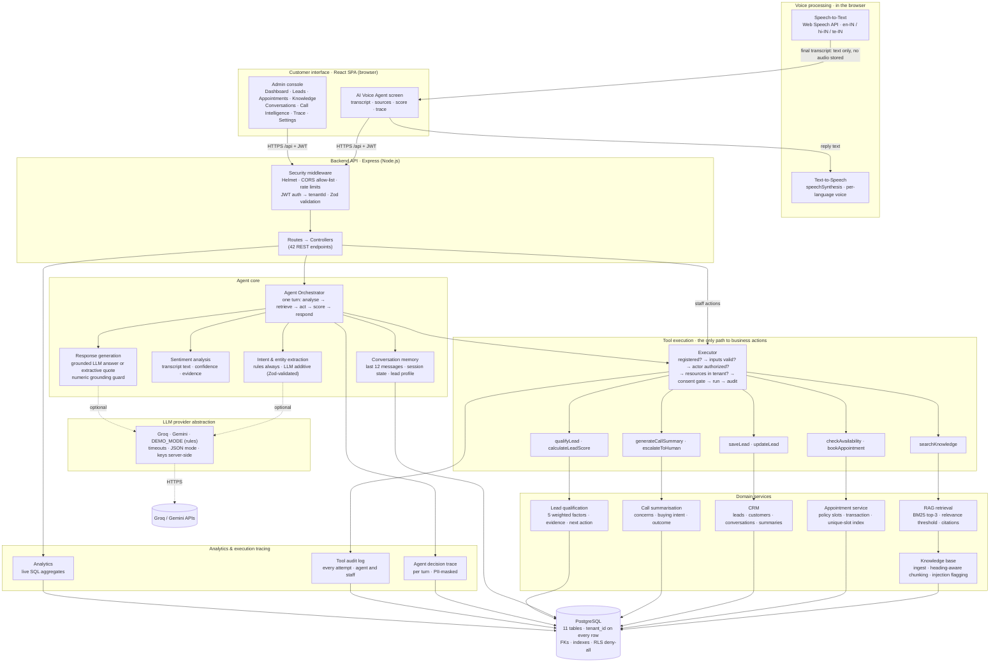
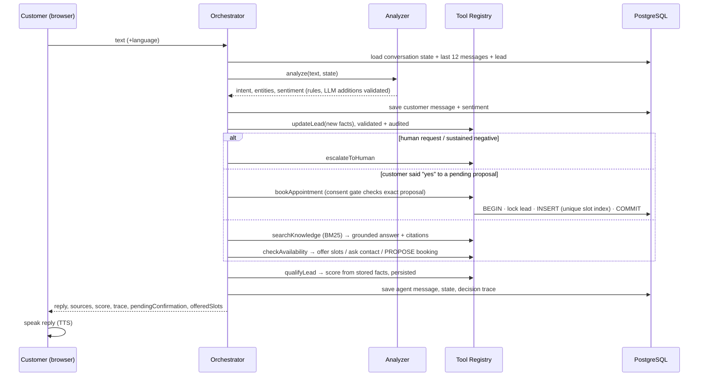
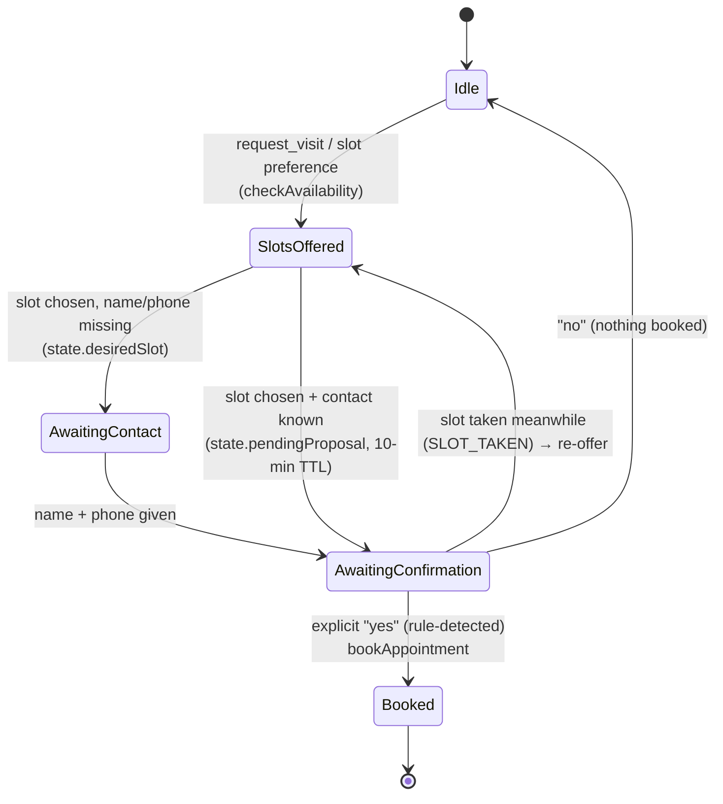
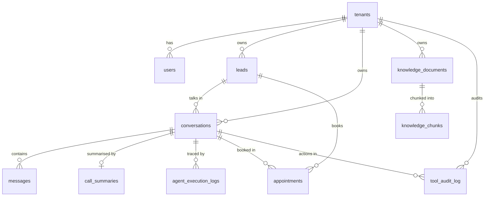

# VaaniQ Architecture

> Status legend used across the docs: **Implemented** (built and covered by tests) · **Partial** (works with stated limits) · **Mocked/Demo** (deterministic stand-in, clearly labelled in the UI) · **Planned** (designed, not built).

## 1. System overview

A **modular monolith**: one Node.js/Express process with clearly separated service modules, one PostgreSQL database, and a React SPA. No microservices: each module could be extracted later, but today the extra network hops and operational cost would buy nothing.

**Hard rule:** the LLM never touches the database or the tools. Model output is *data* that is validated, merged with deterministic rules, and turned into tool calls by backend code. Customer consent for a booking is recognised only by deterministic rules on the customer's own words.

| Component | Status | Notes |
|---|---|---|
| Customer interface (8 + 1 pages), responsive | Implemented | 375 / 768 / 1440 px checked |
| Voice processing (browser STT/TTS) | Partial | depends on browser support and installed voices; feature-detected with text fallback |
| Backend API, auth, validation, rate limits | Implemented | 42 endpoints |
| Agent orchestrator, memory, NLU, sentiment | Implemented | rule NLU is the always-on baseline |
| LLM provider | Implemented (Groq live-verified) · Gemini adapter-tested only | DEMO_MODE when no key |
| RAG (BM25) + knowledge base | Implemented | embeddings/pgvector **planned** |
| Tool execution, audit | Implemented | 9 tools |
| Lead qualification, appointments, CRM, summaries | Implemented | |
| Analytics & tracing | Implemented | OpenTelemetry **planned** |
| Telephony, calendar sync, SMS/WhatsApp | Planned | |
| Company data and customers | Mocked/Demo | fictional "ABC Developers", labelled DEMO |

## 2. One agent turn (request flow)

`POST /api/conversations/:id/messages { text, language }` → `services/agent/orchestrator.js#handleTurn`

## 3. Booking state machine (stored in `conversations.state`)

## 4. Data model

Key constraints (from `backend/src/db/migrations/001_init.sql`):
- Every business table has `tenant_id` (FK, `ON DELETE CASCADE`) and indexes that lead with `tenant_id`.
- `appointments_slot_uq`: `UNIQUE (tenant_id, starts_at) WHERE status = 'confirmed'`. The database itself prevents double-booking.
- `leads_tenant_phone_uq`: one lead per phone per tenant (repeat-caller merge).
- `call_summaries.conversation_id UNIQUE`: one summary per call, upserted.
- CHECK constraints on every status/enum column and on `score BETWEEN 0 AND 100`.

## 5. Module responsibilities

| Module | Responsibility |
|---|---|
| `agent/orchestrator.js` | Runs a turn: decides the primary action, calls tools, composes the reply, persists the trace |
| `agent/analyzer.js` | Rule NLU always; optional LLM JSON analysis validated with Zod and merged *additively* |
| `agent/responder.js` | Answers from retrieved chunks only (LLM-grounded or extractive) |
| `agent/context.js` | Follow-up context for retrieval (previous topic + stated BHK), only when the message refers back |
| `agent/output.js` | Zod schema for the structured turn output, suggested action, explanation |
| `agent/templates.js` | EN/HI/TE fragments. Booking/slot statements are always templated |
| `controllers/*` | HTTP layer: read validated input, call services, shape the `{ data }` response (routes only declare paths, middleware and schemas) |
| `tools/definitions.js` | The 9 tool definitions: schema, actors, scope, consent requirement (no behaviour) |
| `tools/handlers.js` | Tool implementations, reachable only through the executor |
| `tools/executor.js` | validate → authorize (actor + tenant scope) → consent gate → execute → audit row |
| `rag/*` | Chunking, BM25, ingestion, retrieval with relevance threshold, query expansion |
| `nlu.js` / `sentiment.js` / `lexicon.js` | Deterministic multilingual extraction, intent flags, sentiment with evidence |
| `leadScoring.js` | Configurable 100-point model with reasons and missing info |
| `memory.js` | Conversations, messages, 12-message window, state persistence |
| `crm.js` | Leads, fact merge (never overwrite with empty), phone merge, status rules |
| `appointments.js` | Slot policy, availability, transactional booking, reschedule, cancel |
| `summary.js` | Structured call summary + rule-based next actions (+ optional LLM narrative) |
| `analytics.js` | Live SQL aggregates for the dashboard and analytics pages |
| `llm/*` | Provider abstraction: `chat({system, messages, json})`, timeouts, no key logging |
