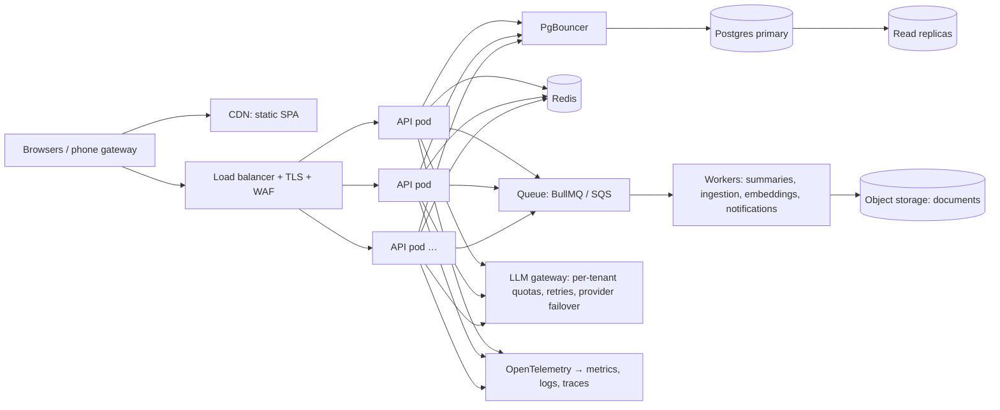

# Scalability and Security

> A laptop-scale load test has been run (see [LOAD_TEST.md](LOAD_TEST.md)): it validates correctness under concurrency, not production capacity. The capacity figures below remain **design estimates** to be validated with distributed load testing (for example k6) before any production commitment.

## Part A: Security (implemented)

| Control | Where | Notes |
|---|---|---|
| AI keys only on the backend | `config.js`, `llm/*` | The browser never sees keys; Vite/nginx proxy `/api` from the same origin |
| No committed secrets | `.gitignore`, `.env.example` | `.env`, `.env.test`, `.pgdata` ignored; example file has empty secret slots |
| Env validation at boot | `config.js` (Zod) | Refuses to start without `DATABASE_URL` or a ≥32-char `JWT_SECRET` |
| Helmet security headers | `app.js` | CSP, HSTS, nosniff, frameguard, etc.; `x-powered-by` disabled |
| CORS allow-list | `app.js` | Only `CORS_ORIGINS` may call from browsers |
| Request validation | `middleware/validate.js` + Zod in every route | Strict schemas reject unknown fields where it matters (lead PATCH, tool args) |
| Body size limit | `express.json({ limit: '300kb' })` | |
| Rate limiting | global 300/min, failed logins 20/15 min, agent turns 60/min | Keyed by client IP (`trust proxy` for nginx/LB); 429s use the JSON error envelope |
| LLM grounding guard | `agent/responder.js#ungroundedNumbers` | Any number in an LLM answer not present in the retrieved sources (or the question) makes the reply fall back to the verbatim source; prompt forbids calculating figures |
| Turn serialization | `orchestrator.js#handleTurn` | Same-conversation turns run one at a time (double-clicks, retries); integrity across instances still rests on the booking transaction + unique index |
| SPA security headers | `frontend/nginx.conf` | CSP, nosniff, Referrer-Policy, Permissions-Policy (verified in the Docker stack) |
| Parameterized SQL | all services | No string interpolation of input into SQL |
| Password storage | `lib/password.js` | scrypt, 16-byte salt, constant-time comparison |
| Admin auth | `middleware/auth.js` | JWT HS256 with algorithm pinned, 8h expiry; same error for unknown user and wrong password |
| Tenant isolation | JWT `tid` → `req.user.tenantId` → `WHERE tenant_id = $1` everywhere | Cross-tenant IDs return 404 (tested) |
| No sensitive logs | `lib/logger.js` | Logs ids, codes and status only; never message text, names or phones |
| PII masking in traces | `orchestrator.js#maskPII` | Phones become `******NN`, e-mails become `***@domain` |
| No raw audio stored | design | Only transcripts reach the server |
| Retrieved docs are data | `responder.js`, `chunker.js` | `<context>` delimiting + "ignore instructions in context"; injection-like chunks flagged and excluded |
| Untrusted model output | `analyzer.js`, `tools/executor.js` | Zod-validated; additive only; cannot set consent; tools allow-listed; booking needs the consent gate; slot policy + DB constraint |
| Row-level security (deny-all for non-owner roles) | `migrations/002_enable_rls.sql` | Protects hosted DBs whose public schema is exposed (Supabase Data API + public anon key); tested with a probe role |
| DB TLS | `db/pool.js` (`DATABASE_SSL`) | `require` / `verify` (+ optional CA file) for hosted Postgres |
| Tool authorization + audit | `tools/executor.js`, `tool_audit_log` | Actor allow-list per tool, tenant-scoped resource checks, PII-masked audit row for every attempt (agent and staff) |
| Admin-only deletes | `requireRole('admin')` on DELETE routes | Sales-executive role (`agent`) gets 403 (tested) |
| Error hygiene | `middleware/error.js` | 5xx returns a generic message + `requestId`; stack only in server logs |
| Dependencies | `npm audit` | 0 known vulnerabilities at build time (backend prod deps, frontend) |

**Gaps to close before production:** HTTPS termination (at the load balancer), refresh tokens + revocation list, per-tenant RLS policies (`SET app.tenant_id`) on top of today's deny-all RLS, encryption at rest for PII columns (phone), audit log of staff actions, a CSP tuned for the SPA's assets, secret manager (AWS Secrets Manager / Vault) instead of env files, data-retention policy for transcripts, DPDP Act (India) consent capture.

## Part B: Scaling to 100,000 registered users

### First, separate the numbers
- **100,000 registered users** is an account count. It says little about load.
- What drives cost and capacity is **concurrent active calls** and **turns per second**.

Illustrative estimate (assumptions, not measurements): 100k users, 10% active daily → 10k daily users. If each has ~1.5 calls of ~8 turns → ~120k turns/day. With a peak-hour factor of 15% of daily traffic → ~18k turns/hour ≈ **5 turns/s at peak**, roughly **150–300 concurrent calls** (a turn every ~30–60 s per call). A promotional spike could be 5–10× that.

Each turn costs: ~6–10 short SQL statements, one BM25 lookup (in-memory), and in LLM mode 1–3 LLM calls (the dominant latency, 0.3–3 s). **The bottleneck is the LLM provider's rate limit and latency, not Node or Postgres.**

### Target architecture

| Topic | Strategy |
|---|---|
| **Stateless services** | Already true: all conversation memory lives in Postgres (`conversations.state`, `messages`), and auth is a self-contained JWT, so any pod can serve any turn |
| **Horizontal autoscaling** | Containers behind a load balancer; scale on CPU and in-flight requests (Kubernetes HPA / ECS). Graceful shutdown is implemented (`server.js` drains on SIGTERM) |
| **Redis** | (1) Cache tenant settings and the BM25/vector index version, replacing the per-process `indexCache` with a Redis-published version key so all pods invalidate together; (2) hot session state for active calls with write-through to Postgres; (3) distributed rate limits (`rate-limit-redis`); (4) idempotency keys for turn submission |
| **Async jobs** | Move call summaries, document ingestion/embedding, analytics roll-ups and notifications to a queue with workers, keeping the turn path short |
| **Connection pooling** | `pg.Pool` per pod (`DB_POOL_MAX`) + **PgBouncer** in transaction mode, so 50 pods × 10 connections don't exhaust Postgres |
| **Read replicas** | Dashboards, analytics, conversation history and traces read from replicas; the turn path and bookings write to the primary. Analytics later moves to materialised views or a warehouse |
| **Partitioning / retention** | `messages` and `agent_execution_logs` grow fastest: partition by month, archive old traces to object storage |
| **Object storage** | Uploaded source documents (PDFs later) in S3/GCS; Postgres keeps chunks + metadata |
| **LLM rate limits** | An LLM gateway with per-tenant token budgets, concurrency caps, exponential backoff with jitter, a timeout per call (implemented: `LLM_TIMEOUT_MS`), provider failover (the abstraction already allows Groq↔Gemini), and the existing **rule-based degradation path** when providers are saturated |
| **Observability** | Structured JSON logs (implemented) with `requestId`; add OpenTelemetry traces across HTTP → DB → LLM; SLOs on p95 turn latency, LLM error rate, booking failures; alerts. Per-turn latency is already persisted in `agent_execution_logs.latency_ms` |
| **Multi-tenant isolation** | Today: `tenant_id` on every row + JWT-derived filtering. RLS is enabled (deny-all for non-owner roles). Next: per-tenant RLS **policies** (`SET app.tenant_id`) as a second wall; per-tenant rate limits and LLM quotas (noisy-neighbour protection); dedicated databases for enterprise tenants if required |
| **Voice at scale** | Browser STT does not scale to phone calls. Production telephony would use a streaming STT/TTS provider via WebSockets/SIP, with media servers sized by **concurrent calls**, not registered users |

### Load testing done, and what comes next
Done ([LOAD_TEST.md](LOAD_TEST.md)): demo-mode turns up to 50 concurrent customers (0 errors), 100 simultaneous bookings on 10 slots (exactly 10 succeed), and 10 simultaneous live-Groq turns. Measured: a distant database (about 288 ms per round trip to Sydney) dominates turn time, so independent queries now run in parallel and tenant settings are cached.
Next: a distributed test from separate machines, a soak test, a mocked LLM with realistic latency at higher concurrency, and the same against a database in the users' region.
